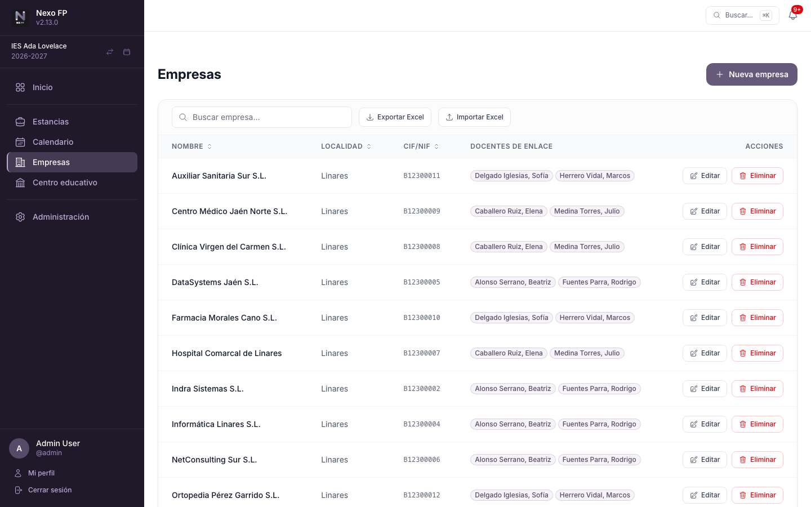
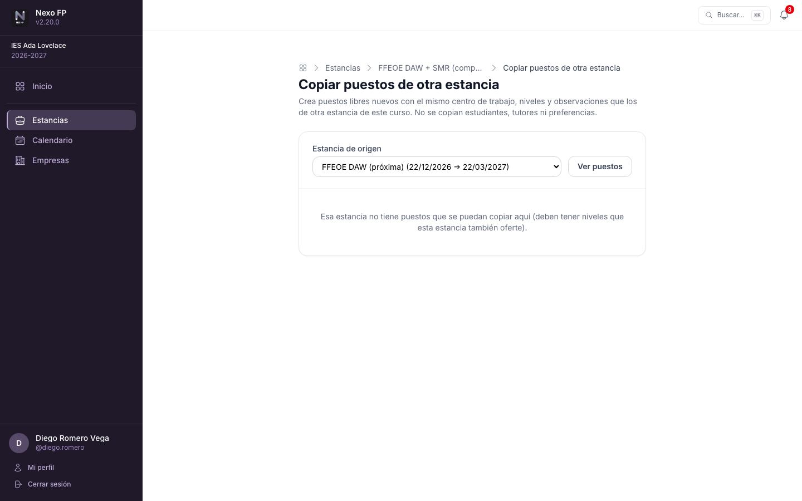
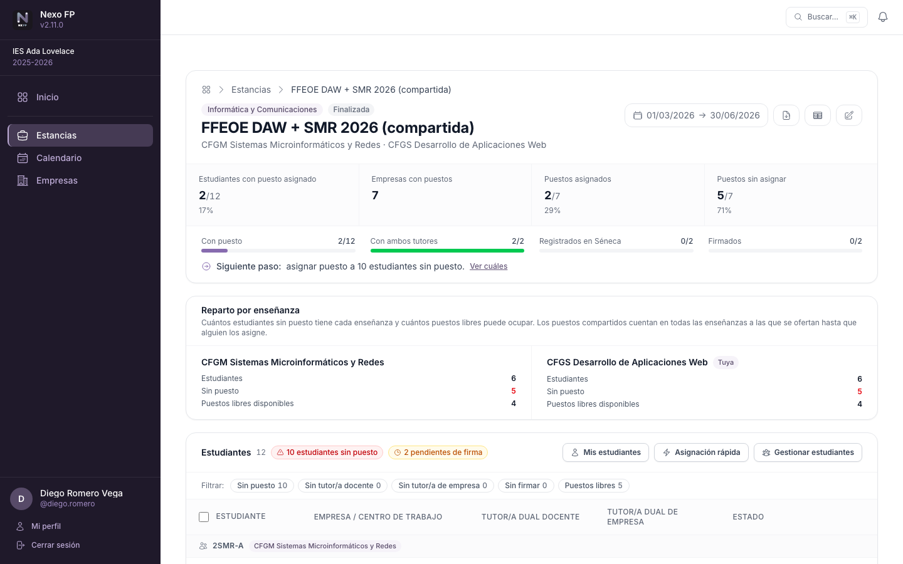
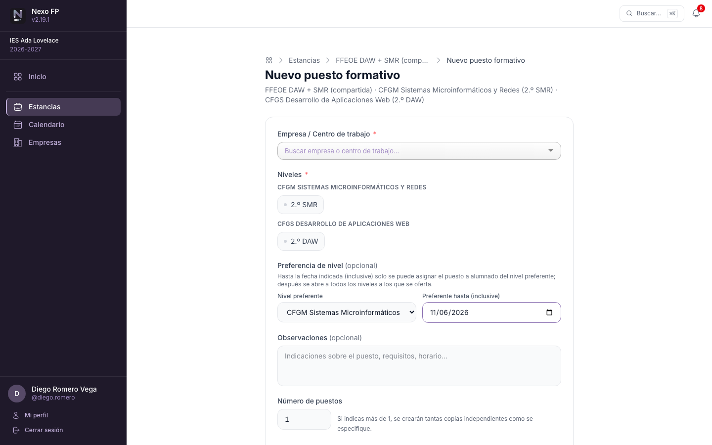
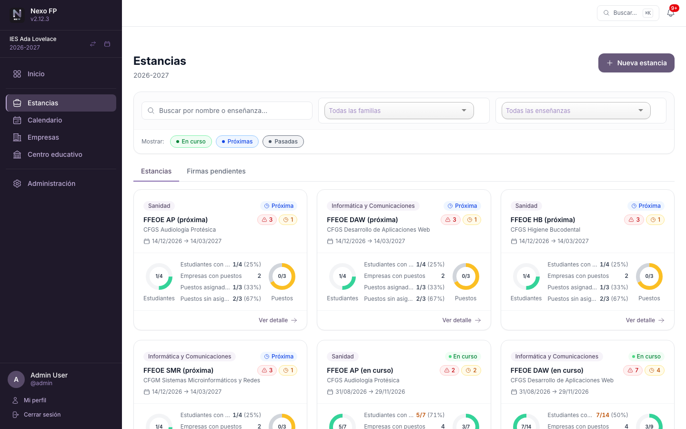
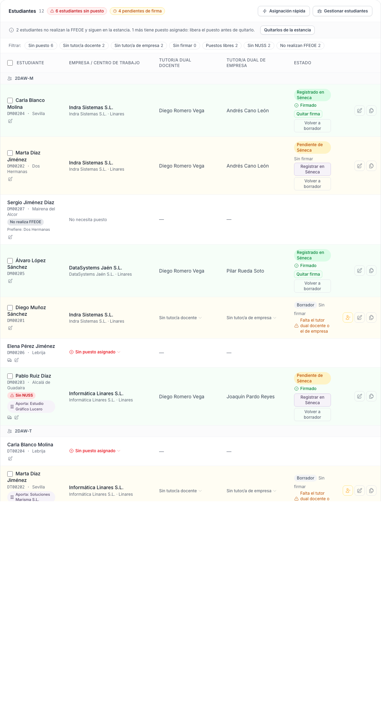
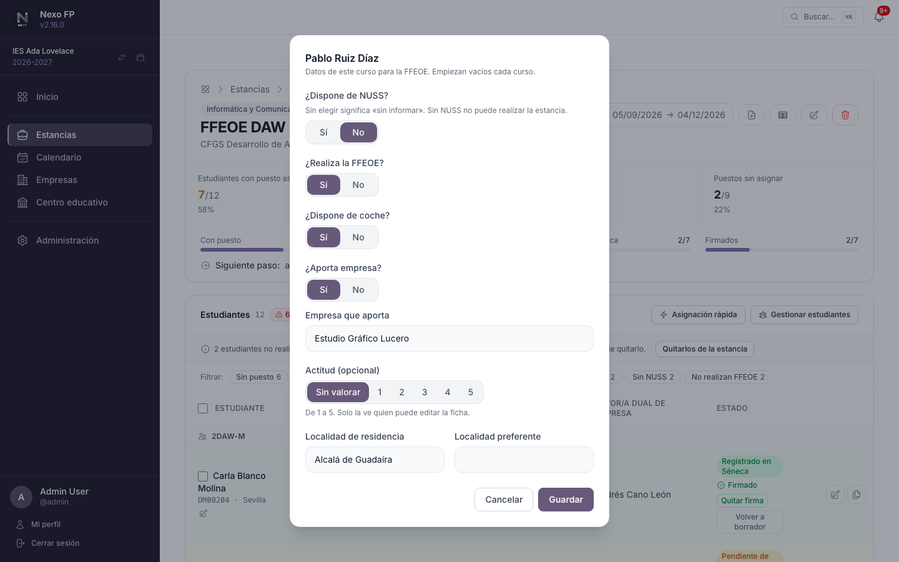
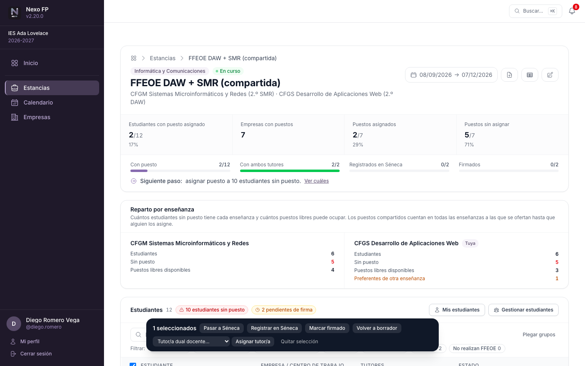
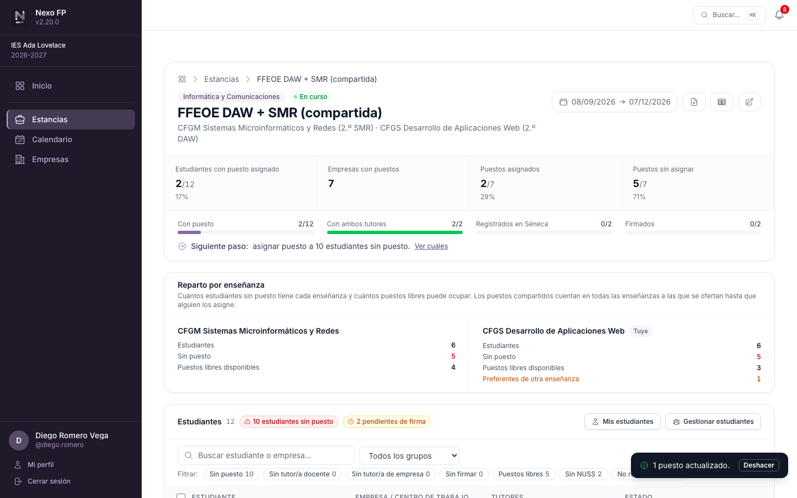

# Flujo de trabajo

El proceso habitual en Nexo FP sigue estas fases, desde que el curso está preparado hasta el cierre de
las estancias. Cada fase indica **quién hace qué**.

!!! info "Antes de empezar"
    Para trabajar con estancias, el equipo directivo ha de haber preparado el curso activo del centro
    (curso académico, oferta formativa, docentes, tutorías y estudiantes). Eso lo hace la administración
    del centro y se explica en [Primeros pasos](22-primeros-pasos.md), en la parte de administración. Si
    no ves tus grupos o estudiantes, consulta con ella.

## 1 — Registrar empresas y centros de trabajo

Antes de crear puestos, el personal con acceso a **Empresas** registra:

1. Las **empresas** colaboradoras con sus datos básicos (nombre, CIF/NIF, localidad).
2. Los **centros de trabajo** (sedes) de cada empresa.
3. Los **empleados** que actuarán como tutores de empresa.
4. Los **docentes de enlace** asignados a cada empresa.



## 2 — Crear estancias y puestos formativos

Una **estancia** agrupa un conjunto de puestos formativos de una o varias enseñanzas dentro de un periodo
concreto (por ejemplo, «DAW y DAM - 2.º curso, marzo-mayo 2027»).

1. En **Estancias → Nueva estancia**, se seleccionan las **enseñanzas** (una o varias) y se define el nombre
   y las fechas.
2. Dentro de la estancia, se añaden los **puestos formativos**: para cada puesto se indica el centro de
   trabajo y los **niveles** a los que se oferta, que pueden ser de cualquiera de las enseñanzas de la
   estancia (así una empresa puede ofrecer un mismo puesto a alumnado de DAW y de DAM).
3. Cada coordinación inscribe a sus **estudiantes** en la estancia para que puedan asignarse a los puestos.

Para ofertar varios puestos iguales, el botón **Duplicar puesto** de cada fila pregunta cuántas copias crear
(hasta 20); también se puede indicar la cantidad al crear un puesto nuevo. Para reutilizar los puestos de
otra estancia del mismo curso (pantalla de la imagen), **Copiar de otra estancia** (junto a *Nuevo puesto*) muestra sus puestos con una
casilla cada uno y crea copias libres con el mismo centro de trabajo, niveles y observaciones (nunca estudiante,
tutores ni preferencia).



### Estancias con varias enseñanzas



- **Cada coordinación gestiona a su alumnado**: solo puede inscribirlo y asignarle puesto a él. El
  alumnado de las demás enseñanzas se ve (con un candado) pero no se puede modificar; el botón
  **Mis estudiantes** filtra la lista al propio.
- **Un puesto, un estudiante**: cuando una coordinación asigna un puesto compartido, deja de estar
  disponible para cualquier otro estudiante, sea o no de la misma enseñanza. Si dos coordinaciones lo
  intentan a la vez, la segunda recibe un aviso con el nombre de quien se ha adelantado y no se pierde
  nada. Las coordinaciones de las demás enseñanzas a las que se ofertaba el puesto reciben un correo.
- **Preferencia temporal**: al crear o editar un puesto compartido se puede indicar una **enseñanza
  preferente** y una fecha límite (inclusive). Hasta esa fecha el puesto solo se puede asignar a alumnado
  de esa enseñanza; después se abre a todas las demás a las que se oferta.
- **Reparto por enseñanza**: un panel resume, para cada enseñanza, cuántos estudiantes tiene, cuántos sin
  puesto y cuántos puestos libres puede ocupar (separando los reservados a otra enseñanza).
- Solo se puede asignar un puesto a un estudiante si está ofertado a su nivel.



- Una enseñanza con alumnado inscrito o con puestos ofertados no se puede quitar de la estancia.



!!! info "Estancias solapadas"
    Una misma enseñanza puede tener **varias estancias que se solapen** en el tiempo: no todos los grupos
    realizan la fase de formación a la vez. Es una situación legítima y la aplicación no la impide.

## 3 — Asignar estudiantes y tutores

Una vez creados los puestos, se completa cada uno con su asignación:

1. Se selecciona el **estudiante** que ocupará el puesto (de entre los de la propia coordinación).
2. Se designa el **tutor/a dual docente** (responsable académico). Si la estancia tiene activado
   **«Calcular asignaciones por docente»**, la sección **Docentes** indica cuántos estudiantes debería
   tutorizar cada docente, según sus horas dualizadas en cada grupo, y cuántos tiene ya asignados (consulta
   [Reparto de tutorías por docente](13-pantallas-de-la-aplicacion.md#reparto-de-tutorias-por-docente)).
3. Se designa el **tutor/a dual de empresa** (responsable en la empresa).
4. Se ajustan las fechas del puesto si difieren de las de la estancia.

Mientras el puesto está en estado **Borrador**, todos los campos son editables. El modo de **asignación
rápida** muestra los selectores en todas las filas a la vez para agilizar el reparto; el navegador recuerda
si lo tenía activado (y el filtro **Mis estudiantes**) al abrir otra estancia.

### Ficha del estudiante en el curso

Cada estudiante tiene en cada curso una **ficha** con los datos que ayudan a decidir su puesto. Empieza
vacía al llegar un curso nuevo (los datos son de ese curso, no del estudiante para siempre):

| Dato | Qué significa |
|------|---------------|
| **¿Dispone de NUSS?** | Sí / No / sin informar. Al importar el alumnado se rellena sola: si la columna `NºSeg.Social` del CSV de Séneca trae valor, dispone de NUSS; si está vacía, no. Sin NUSS no se puede realizar la estancia. |
| **¿Realiza la FFEOE?** | Sí por defecto. Si es **No**, hay que indicar el **motivo** (por ejemplo, que ya la realizó o que tiene suspendido PRL). |
| **¿Dispone de coche?** | Sí / No. |
| **¿Aporta empresa?** | Si es **Sí**, se indica la empresa que aporta (texto libre). |
| **Actitud** | De 1 a 5, opcional. |
| **Localidad de residencia** | Se rellena al importar (columna `Localidad de residencia`). |
| **Localidad preferente** | Texto libre: dónde le gustaría hacer la FFEOE si no es su localidad de residencia. |



La lista de estudiantes de la estancia solo destaca lo que merece atención:

- **Sin NUSS** (insignia roja): el estudiante realiza la FFEOE pero consta que no tiene NUSS, así que no
  podrá hacer la estancia. Quien aún está *sin informar* no se marca.
- **No realiza FFEOE** (insignia gris, con el motivo al pasar el ratón por encima).
- **Aporta: empresa**, el icono del **coche** y la **localidad preferente**; la localidad de residencia
  aparece bajo el nombre.

Hay dos **filtros rápidos** nuevos, *Sin NUSS* y *No realizan FFEOE*, y el mismo filtro en
**Centro educativo → Estudiantes**. El inicio añade a **Atención ahora** la tarea «N estudiantes que realizan
la FFEOE sin NUSS».



El **lápiz** junto a cada estudiante abre la ficha en un diálogo. La **actitud** y la edición de la ficha son
solo para quien puede asignar puesto al estudiante (administración del centro, coordinación de sus
enseñanzas, jefatura de su familia) y para la **tutoría de sus grupos**; el resto del profesorado ve los
demás datos pero no la actitud. Un curso anterior es de solo lectura.

Quien **no realiza la FFEOE**:

- No cuenta como «sin puesto» ni en el avance, la cobertura o el reparto de tutorías por docente, y no se le
  puede asignar puesto mientras no cambie su ficha.
- Mientras siga inscrito en la estancia, un aviso sobre la lista ofrece **Quitarlos de la estancia** de una
  vez (solo a los que no tienen puesto; los que ya lo tienen se señalan para liberar su puesto antes).
- Si el estudiante **no tiene NUSS**, la aplicación avisa antes de asignarle un puesto y hay que confirmar.

El **NIE** solo se muestra en la ficha del estudiante (Centro educativo → Estudiantes), no en los listados de
la interfaz. El Excel de la estancia lo mantiene e incluye además las columnas NUSS, Realiza FFEOE, Coche,
Empresa aportada y las dos localidades, pero nunca la actitud.

## 4 — Estados del puesto y tramitación en Séneca

Cada puesto formativo recorre un ciclo de vida:

```
Borrador → Pendiente de Séneca → Registrado en Séneca
```

1. Para salir de **Borrador** hay que asignar **ambos tutores** (docente y de empresa).
2. Cuando la asignación está lista, el estado pasa a **Pendiente de Séneca**.
3. Una vez confirmada la recepción en Séneca, se marca como **Registrado en Séneca** y el convenio se
   registra como firmado. La casilla **Firmado** solo se habilita en este estado.
4. Los puestos en estado **Registrado** quedan bloqueados para evitar modificaciones accidentales; se
   puede volver a *Borrador* para corregir datos.

Desde el detalle de la estancia, cada fila ofrece los pasos disponibles (**Pasar a Séneca**,
**Registrar en Séneca**, **Marcar firmado**, **Volver a borrador**) sin abrir la ficha del puesto. Si falta
algún tutor, la fila lo indica. Cada cambio muestra un aviso con **Deshacer** durante unos segundos; lo
mismo ocurre al **liberar el puesto** de un estudiante, que no pide confirmación: si se deshace, vuelve el
estudiante con sus tutorías (siempre que el puesto siga libre y el estudiante no tenga otro).



Para varios puestos a la vez, marque las casillas junto a cada estudiante (o la de la cabecera para
seleccionarlos todos): aparece una barra con las acciones masivas. Los puestos que no se pueden cambiar
(de otra coordinación o sin tutores) se omiten y el aviso indica cuántos. La pestaña **Firmas pendientes**
de Estancias permite también marcar varios como firmados de una vez. El aviso de la acción incluye
**Deshacer** (hasta 60 puestos), que devuelve cada puesto a su estado, firma y tutor/a anteriores.
Al eliminar un puesto libre, la estancia ofrece durante unos minutos un aviso con **Deshacer** para
volver a crearlo con sus datos.



La cabecera de la estancia muestra el **avance** del proceso (alumnado con puesto, con ambos tutores,
registrado en Séneca y firmado) y el **siguiente paso recomendado**, con un enlace para ver las filas
afectadas.

Sobre la lista de estudiantes hay **filtros rápidos** (*Sin puesto*, *Sin tutor/a docente*, *Sin tutor/a de
empresa*, *Sin firmar*, *Puestos libres*, *Sin NUSS* y *No realizan FFEOE*) con el número de filas de cada
uno. La campana de notificaciones
y el bloque **Atención ahora** del inicio abren la estancia con el filtro ya aplicado.

!!! tip "Ten en cuenta"
    La aplicación bloquea las transiciones inválidas y avisa de lo que falta en cada momento.

## 5 — Generar informes

En cualquier momento se puede descargar el **informe PDF** de cada estancia con el detalle completo de
todos los puestos, estudiantes, tutores y fechas, o exportar los datos a **Excel**.
