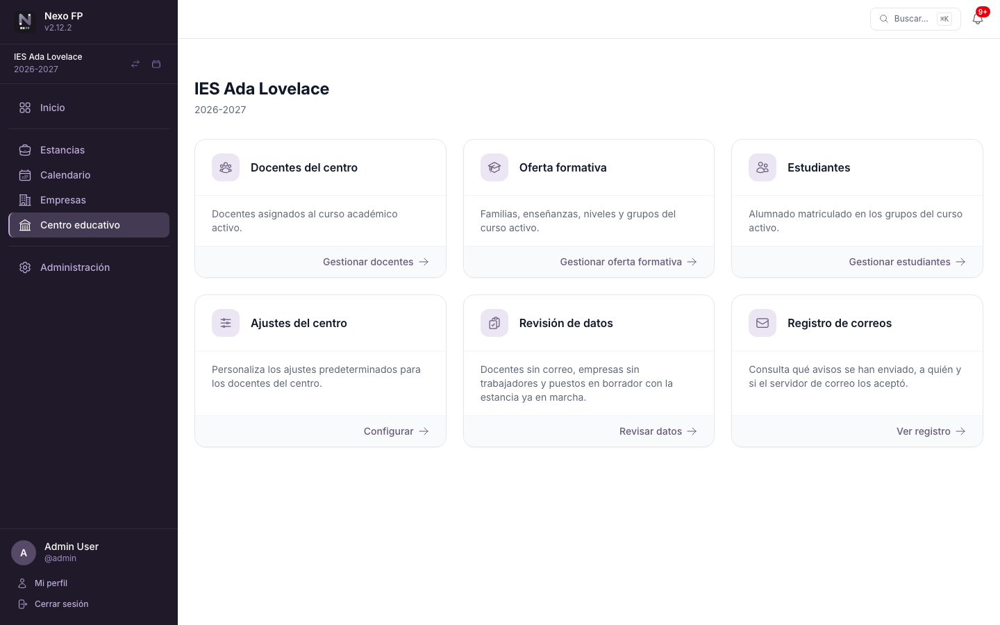
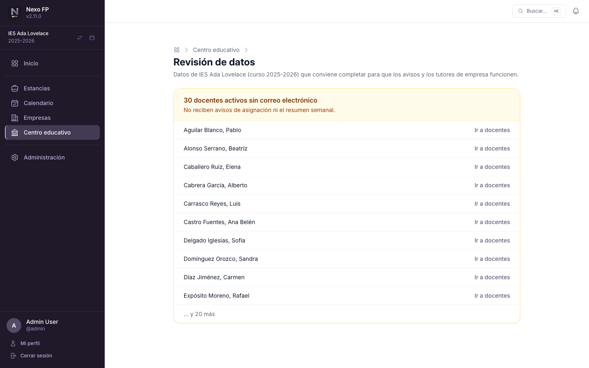
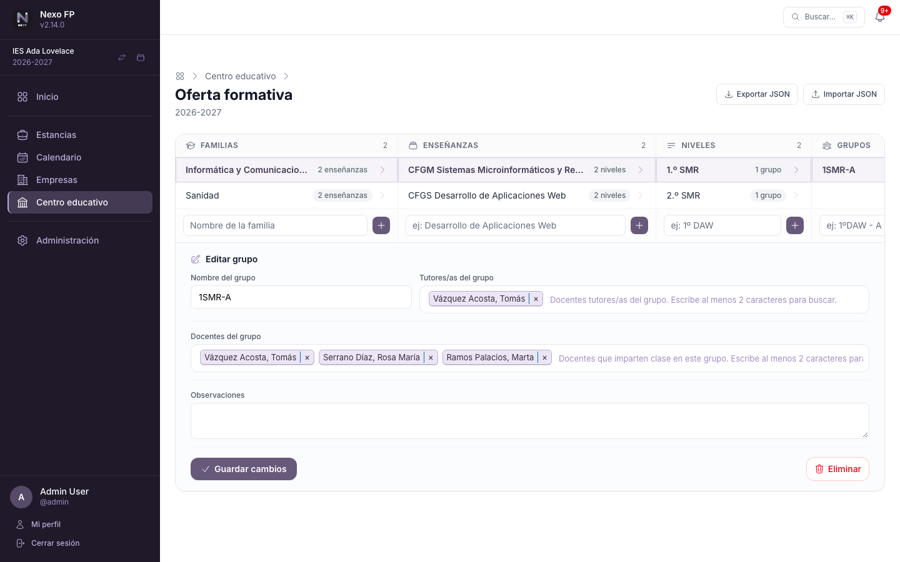
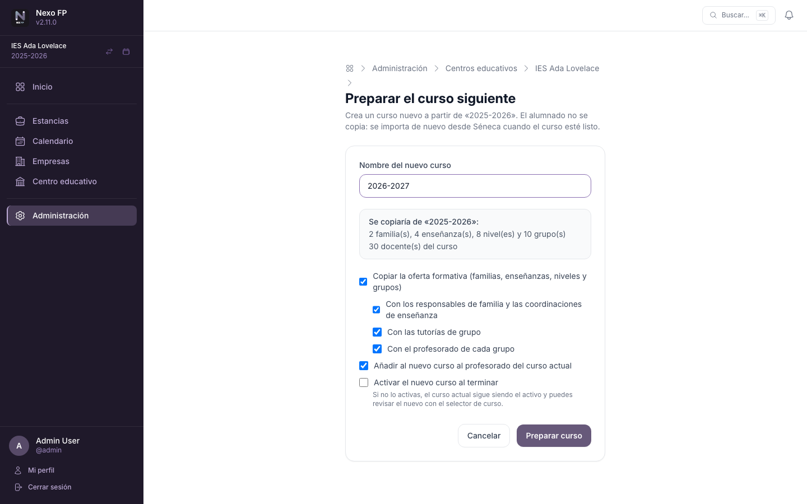
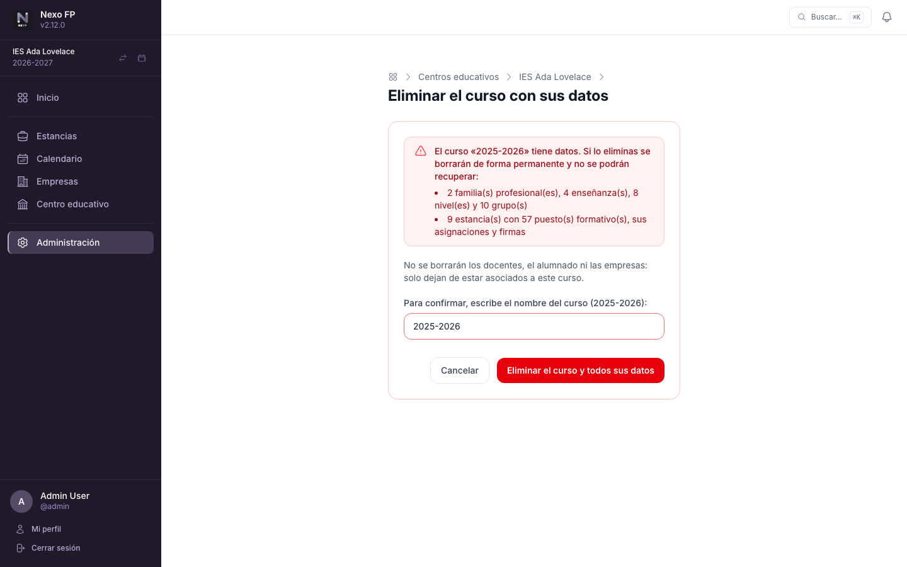

# Centro y cursos

Esta sección describe **Centro Educativo**, que reúne la gestión interna de cada centro, y las
herramientas para trabajar con cursos académicos: consultar uno anterior, copiar la oferta al curso
siguiente y eliminar un curso. La preparación inicial, paso a paso, está en
[Primeros pasos](22-primeros-pasos.md).

## Centro Educativo

Gestión interna del centro. Reúne en un único espacio:

- **Docentes del curso:** alta, baja e importación del personal adscrito al curso activo.
- **Estudiantes:** alta, edición, baja e importación masiva desde CSV (formato de exportación de Séneca;
  ver [Primeros pasos](22-primeros-pasos.md#formato-del-csv-de-importacion)).
- **Oferta formativa:** estructura jerárquica completa (familias profesionales → enseñanzas → niveles →
  grupos, con asignación de tutor y docentes a cada grupo). Incluye **exportación e importación en JSON**
  para copiar la estructura entre cursos o centros (ver más abajo).
- **Cursos académicos:** crear y activar cursos del centro.
- **Registro de correos:** qué avisos por email se han enviado a los docentes del centro y si el servidor de
  correo los aceptó (ver [Control y registro de correos](26-control-y-registro-de-correos.md#registro-de-correos-enviados)).
- **Revisión de datos:** lista lo que conviene completar para que todo funcione: docentes activos sin correo
  (no reciben avisos ni el resumen semanal), empresas con puestos en el curso pero sin ningún trabajador
  (no se les puede asignar tutor de empresa) y estancias en marcha, o que empiezan en dos semanas, con
  alumnado cuyo puesto sigue en borrador. Cada elemento enlaza con la pantalla donde corregirlo.

  

### Estructurar la oferta formativa

La oferta se gestiona en una sola pantalla con **navegación en columnas**: al seleccionar una familia
se muestran sus enseñanzas, al elegir una enseñanza aparecen sus niveles y, dentro de cada nivel, sus
grupos. Cada nueva columna se va rellenando sin recargar la página, y un buscador ayuda a localizar
familias en ofertas grandes.

El elemento seleccionado se **edita en el mismo panel**, sin pasar a otra pantalla: su nombre, sus
observaciones y el personal asociado (responsable de familia, coordinadores/as de la enseñanza y
tutores/as y docentes de cada grupo). Los cambios de personal se guardan al instante; el resto se
confirma con **Guardar cambios**.

### Exportar e importar la oferta formativa

Desde la página principal de **Oferta formativa** están disponibles dos acciones:

- **Exportar JSON** — descarga un fichero `.json` con toda la estructura del curso activo: familias
  profesionales, enseñanzas, niveles, grupos y los nombres de usuario de los docentes asignados
  (responsable de familia, coordinadores de enseñanza, docentes y tutores de cada grupo).
- **Importar JSON** — carga un fichero exportado previamente y crea o actualiza la estructura en el
  curso activo del centro. Si una familia, enseñanza, nivel o grupo con el mismo nombre ya existe, se
  actualiza (no se duplica). Los docentes se buscan por nombre de usuario; si alguno no existe en el
  servidor de destino, su asignación se omite y el mensaje de resultado indica qué usuarios no se
  han encontrado.

El caso de uso habitual es **copiar la oferta de un curso al siguiente**: exporta el curso actual,
activa el nuevo curso académico e importa el fichero.

## Cambio de curso académico

Las **administraciones de centro y global** pueden visualizar datos de cursos académicos anteriores sin
alterar el curso activo. En la barra lateral, junto al nombre del curso, aparece un icono de calendario;
al pulsarlo se abre el **selector de curso**, que lista todos los cursos del centro. Basta con hacer clic
en el que se desea consultar.

Mientras se visualiza un curso histórico:

- Un **banner ámbar** aparece en la parte superior de cada página recordando qué curso se está viendo y
  ofreciendo un botón de vuelta al curso activo. Indica además que las estancias y los puestos
  formativos son de solo lectura.
- El nombre del curso en la barra lateral se muestra en **color ámbar** para mayor visibilidad.
- El **listado de estancias**, el **panel de inicio** y el **calendario** muestran los datos del curso
  seleccionado, incluyendo sus estancias y puestos formativos.
- Las **acciones de escritura** quedan bloqueadas: no es posible crear, editar ni eliminar estancias,
  estudiantes, docentes del curso ni familias/enseñanzas. Los botones correspondientes desaparecen de
  la interfaz y, si se intenta acceder a esas acciones directamente, la aplicación lo impide mostrando
  un mensaje de acceso denegado.
- Las **acciones de solo lectura** siguen disponibles: ver listados, exportar a Excel o JSON, generar
  informes y navegar por la estructura de enseñanzas del curso histórico.

Para volver al curso activo en cualquier momento: pulsar el botón **«Volver al curso activo»** del
banner, o usar el selector de curso en la barra lateral.

!!! info "El curso activo no cambia"
    Cambiar el curso visualizado es una preferencia de sesión: solo afecta a la propia sesión de quien
    administra y no modifica el curso activo del centro. El resto de docentes siguen viendo el curso
    activo sin ningún cambio.

## Preparar el curso siguiente

Para no hacerlo a mano, la administración global dispone del botón **Preparar curso siguiente** en
**Administración → Centros educativos → (centro) → Cursos académicos**. El asistente propone el nombre del
nuevo curso (por ejemplo, «2025-2026» → «2026-2027») y crea de una vez:

- el **curso nuevo**;
- la **oferta formativa** copiada del curso activo (familias, enseñanzas, niveles y grupos), con o sin los
  responsables de familia, las coordinaciones de enseñanza, las tutorías y el profesorado de cada grupo;
- el **profesorado** del curso actual, añadido también al nuevo.

Opcionalmente activa el curso nuevo al terminar; si no, el curso actual sigue activo y el nuevo se puede
revisar con el selector de curso. El alumnado **no se copia**: se importa de nuevo desde Séneca.

## Eliminar un curso

Un curso que no es el activo se puede eliminar desde la misma lista. Si no tiene oferta formativa ni
estancias se elimina directamente. Si **tiene datos**, la aplicación muestra una pantalla de confirmación con
lo que se perdería (familias, enseñanzas, niveles, grupos, estancias y puestos con sus asignaciones y firmas)
y pide **escribir el nombre del curso** para continuar. Es irreversible; los docentes, el alumnado y las
empresas no se borran, solo dejan de estar asociados al curso. El curso activo no se puede eliminar (su
botón no aparece). La eliminación queda registrada en el [registro de actividad](24-administracion-global.md#registro-de-actividad).

!!! warning "Haz una copia antes de borrar"
    La eliminación no se puede deshacer. Si quieres conservar los datos del curso, haz antes una copia de
    seguridad (consulta [Operación y mantenimiento](34-operacion-y-mantenimiento.md#copias-de-seguridad)).
