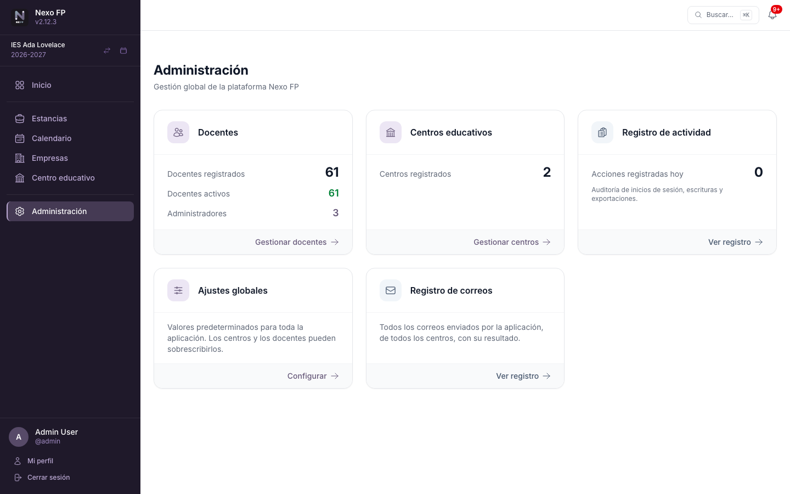

# Administración global

Sección exclusiva para **administradores globales**. Permite:

- Gestionar todos los **docentes** del sistema (alta, baja, activación, asignación de rol de
  administrador, tipo de autenticación).
- Gestionar **centros educativos**: crearlos, asignarles el equipo directivo y gestionar sus cursos
  académicos (incluido el asistente [Preparar curso siguiente](23-centro-y-cursos.md#preparar-el-curso-siguiente)).
- Consultar el **registro de actividad** (ver sección siguiente) y el **registro de correos enviados**
  (ver [Control y registro de correos](26-control-y-registro-de-correos.md#registro-de-correos-enviados)).
- Configurar los **ajustes globales** de la plataforma (notificaciones, tamaño de página…); consulta
  [Ajustes y bloqueos](25-ajustes-y-bloqueos.md).
- Descargar, guardar y programar **copias de seguridad** de todos los datos
  ([más abajo](#copias-de-seguridad)) y comprobar el **estado del sistema** (el proceso de segundo
  plano, los mensajes fallidos, el correo y el espacio ocupado; [más abajo](#estado-del-sistema)).

## Tipo de acceso de cada docente

Al dar de alta o editar un docente se le asigna su **tipo de autenticación**:

- **Acceso local:** la contraseña la gestiona Nexo FP. El docente puede restablecerla por correo
  electrónico.
- **Acceso externo (Séneca/iSéneca):** el docente entra con su usuario y contraseña de Séneca; la
  contraseña no se guarda en Nexo FP.

El acceso externo solo está disponible si quien despliega la aplicación lo ha habilitado (consulta
[variables de entorno](32-despliegue.md#variables-de-entorno-opcionales)); si no, todos los accesos son
locales. Para más detalles sobre cómo entra cada docente, consulta
[Acceso a la plataforma](11-acceso-a-la-plataforma.md).

## Administradores globales

Se crea al menos uno durante el primer arranque (`admin` / `admin`: **cambia esa contraseña de
inmediato**). Se pueden crear más desde esta sección o desde la línea de comandos con
[`app:create-admin`](35-comandos-de-consola.md#appcreate-admin). Un administrador global puede además
**suplantar la identidad** de cualquier usuario para solucionar problemas; cada inicio y fin de
suplantación queda anotado en el registro de actividad.

## Copias de seguridad

La tarjeta **Copias de seguridad** del panel de Administración (`/admin/sistema`) reúne todo lo
necesario para no perder los datos. Todo lo que guarda Nexo FP vive en la base de datos, así que la copia
contiene la plataforma completa: centros, cursos, personas, estancias, empresas, ajustes y registros.
Funciona igual en SQLite, PostgreSQL y MySQL/MariaDB.

- **Descargar copia de seguridad.** Genera un `.zip` y lo descarga en tu ordenador. Si escribes una
  **contraseña**, el fichero se cifra (AES-256) y solo se abre con ella; **si la olvidas, la copia no se
  puede recuperar**.
- **Guardar en el servidor.** Deja una copia, sin cifrar, en la carpeta de copias del servidor (la
  muestra la propia pantalla; se cambia con `APP_BACKUP_DIR`, ver
  [Variables de entorno](32-despliegue.md#variables-de-entorno-opcionales)). Las copias guardadas se listan con su
  fecha, tamaño y versión, y se pueden **descargar** (para llevarlas a otra máquina) o **eliminar**.
  Las que dejas en esa carpeta con `app:backup` o por SSH también aparecen; las que no se pueden leer
  (cifradas con contraseña, dañadas) se listan igualmente, sin detalles. Por seguridad, **no se pueden
  subir copias desde el navegador**.
- **Copias automáticas.** Con el ajuste global **Copias automáticas** activado
  ([Ajustes y bloqueos](25-ajustes-y-bloqueos.md)), cada noche a las 02:30 se guarda una copia sin cifrar
  en la carpeta de copias y se borran las antiguas: se conserva la más reciente de cada uno de los últimos
  *N* días, de las últimas *N* semanas y de los últimos *N* meses (por defecto 7, 4 y 3), y, si se indica
  un **espacio máximo**, se borran las más antiguas hasta que quepan (la más reciente se conserva
  siempre). **Las copias que guardas a mano nunca se borran.** Necesita el proceso de segundo plano
  (*worker*) en marcha. El resultado de la última ejecución se ve en esta pantalla y en el
  [estado del sistema](#estado-del-sistema).
- **Aviso de copia antigua.** La pantalla y la tarjeta del panel avisan cuando la última copia (de
  cualquier tipo) tiene más de 7 días, o si no hay ninguna.

!!! warning "Cuida las copias"
    La copia contiene datos personales del alumnado y los hashes de las contraseñas: guárdala en un lugar
    seguro y bórrala cuando ya no la necesites. Cada descarga queda anotada en el
    [registro de actividad](#registro-de-actividad). Una copia en el mismo disco del servidor no te
    protege si el disco falla: descarga de vez en cuando alguna a otro sitio. La copia **no incluye** el
    `APP_SECRET`, que debes guardar aparte.

**Restaurar** una copia sustituye todos los datos, por eso no se hace desde la web: se hace en el
servidor con [`app:restore`](35-comandos-de-consola.md#apprestore). Los detalles del formato y del cifrado
están en [Operación y mantenimiento](34-operacion-y-mantenimiento.md#copias-de-seguridad).

## Estado del sistema

La tarjeta **Estado del sistema** (`/admin/estado`) comprueba que lo que ocurre «por detrás» funciona:

- **Tareas en segundo plano.** El proceso de segundo plano (*worker*) envía los correos, los
  recordatorios y las copias automáticas. Escribe una señal de vida cada 5 minutos; la pantalla dice cuándo
  fue la última y avisa en rojo si lleva más de 15 minutos sin darla. El panel de Administración también
  lo resume en su tarjeta.
- **Mensajes fallidos.** Las tareas en segundo plano que agotaron sus reintentos (un correo que no salió,
  por ejemplo) se listan con el motivo, y se pueden **reintentar** (vuelven a la cola y el *worker* las
  intenta de nuevo) o **descartar**. El panel avisa si hay alguno.
- **Correo de prueba.** Envía un mensaje de prueba **a tu propia dirección** (nunca a otra) para comprobar
  la [configuración del correo](33-configuracion-del-correo.md); si falla, muestra el motivo que devuelve el
  servidor de correo. Como mucho tres veces cada 15 minutos.
- **Mercure (sincronización en vivo).** El botón **Comprobar Mercure** publica un aviso de prueba, sin
  datos y en un canal que nadie escucha, en el hub que da la actualización en vivo de las estancias. Si lo
  acepta, el hub está en marcha, la aplicación llega a él (`MERCURE_URL`) y la clave de publicación
  (`MERCURE_JWT_SECRET`) coincide; si no, la pantalla dice por qué (el hub no responde, rechaza la clave,
  falta `MERCURE_URL`…). Aunque falle, las estancias siguen funcionando: solo dejan de actualizarse solas.
  No comprueba la conexión del navegador con la URL pública. Ver
  [Sincronización en vivo](32-despliegue.md#sincronizacion-en-vivo-mercure).
- **Espacio.** Lo que ocupa la base de datos, lo que ocupan las copias guardadas y el espacio libre en el
  disco de las copias.

Reintentar o descartar un mensaje, enviar el correo de prueba y comprobar Mercure quedan anotados en el registro de
actividad.

## Registro de actividad

El registro de actividad es una herramienta de auditoría que guarda un historial de las acciones
realizadas en la plataforma: inicios y cierres de sesión, suplantaciones de usuario, operaciones de
escritura (crear, editar, eliminar) y exportaciones de datos.

Para acceder, pulsa la tarjeta **Registro de actividad** en el panel de Administración.

### Qué se registra

| Categoría | Ejemplos |
|-----------|---------|
| **Sesión** | Inicio de sesión, cierre de sesión, inicio/fin de suplantación de usuario |
| **Escrituras** | Cualquier formulario enviado: crear una estancia, editar un estudiante, importar docentes… |
| **Exportaciones** | Descarga de datos a Excel o JSON |
| **Eliminación de cursos** | `year.deleted`: centro, curso y número de elementos eliminados (familias, enseñanzas, niveles, grupos, estancias y puestos) |

Cada entrada almacena la **fecha y hora exacta**, la **dirección IP** del usuario, el **usuario que
realizó la acción** y, si hay suplantación activa, el **usuario que la ejecutó realmente**. También
se guarda el **centro educativo y curso académico** sobre los que se actuó, cuando corresponde, y un
campo de **datos adicionales** con información específica de la acción (ruta, método HTTP y código de
respuesta).

### Filtros disponibles

El listado se puede acotar por:

- **Rango temporal** — introduce fechas de inicio y fin manualmente o usa los accesos rápidos
  («Última hora», «Últimas 24 h», «Última semana», «Último mes»).
- **Usuario** — busca por nombre o nombre de usuario; el campo autocompleta mientras escribes.
- **Centro educativo** — muestra solo las acciones relacionadas con un centro concreto.
- **Curso académico** — disponible una vez seleccionado el centro.
- **Tipo de acción** — filtra por una acción específica (`session.login`, `app_stays_new`…).

Las columnas **Fecha / hora**, **IP** y **Tipo de acción** son ordenables haciendo clic en su
cabecera.

### Retención y privacidad

Las entradas se conservan durante **90 días** y, pasado ese plazo, una tarea automática semanal las
elimina (el plazo lo fija quien despliega la aplicación; consulta
[variables de entorno](32-despliegue.md#variables-de-entorno-opcionales)). Si se elimina un usuario o un
curso académico, sus referencias en el registro se anulan pero la entrada permanece.

!!! info "Solo para administradores globales"
    El registro de actividad es visible únicamente para administradores globales; los administradores
    de centro no tienen acceso a él.

!!! tip "Activar o desactivar el registro"
    El registro está activado por defecto. Quien despliega la aplicación puede desactivarlo (variable
    `APP_LOG`, ver [Referencia de variables](32-despliegue.md#variables-de-entorno-opcionales)).
