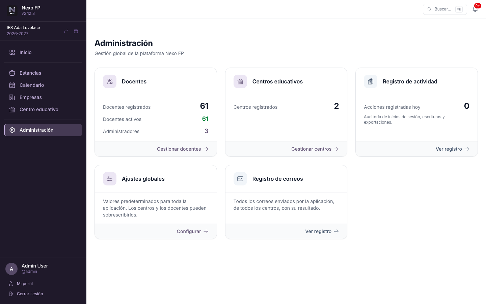

# Administración global

Sección exclusiva para **administradores globales**. Permite:

- Gestionar todos los **docentes** del sistema (alta, baja, activación, asignación de rol de
  administrador, tipo de autenticación).
- Gestionar **centros educativos**: crearlos, asignarles el equipo directivo y gestionar sus cursos
  académicos (incluido el asistente [Preparar curso siguiente](23-centro-y-cursos.md#preparar-el-curso-siguiente)).
- Consultar el **registro de actividad** (ver sección siguiente) y el **registro de correos enviados**
  (ver [Control y registro de correos](26-control-y-registro-de-correos.md#registro-de-correos-enviados)).
- Configurar los **ajustes globales** de la plataforma (notificaciones, tamaño de página…); consulta
  [Ajustes y bloqueos](25-ajustes-y-bloqueos.md).

## Tipo de acceso de cada docente

Al dar de alta o editar un docente se le asigna su **tipo de autenticación**:

- **Acceso local:** la contraseña la gestiona Nexo FP. El docente puede restablecerla por correo
  electrónico.
- **Acceso externo (Séneca/iSéneca):** el docente entra con su usuario y contraseña de Séneca; la
  contraseña no se guarda en Nexo FP.

El acceso externo solo está disponible si quien despliega la aplicación lo ha habilitado (consulta
[variables de entorno](32-despliegue.md#variables-de-entorno-opcionales)); si no, todos los accesos son
locales. Para más detalles sobre cómo entra cada docente, consulta
[Acceso a la plataforma](11-acceso-a-la-plataforma.md).

## Administradores globales

Se crea al menos uno durante el primer arranque (`admin` / `admin`: **cambia esa contraseña de
inmediato**). Se pueden crear más desde esta sección o desde la línea de comandos con
[`app:create-admin`](35-comandos-de-consola.md#appcreate-admin). Un administrador global puede además
**suplantar la identidad** de cualquier usuario para solucionar problemas; cada inicio y fin de
suplantación queda anotado en el registro de actividad.

## Registro de actividad

El registro de actividad es una herramienta de auditoría que guarda un historial de las acciones
realizadas en la plataforma: inicios y cierres de sesión, suplantaciones de usuario, operaciones de
escritura (crear, editar, eliminar) y exportaciones de datos.

Para acceder, pulsa la tarjeta **Registro de actividad** en el panel de Administración.

### Qué se registra

| Categoría | Ejemplos |
|-----------|---------|
| **Sesión** | Inicio de sesión, cierre de sesión, inicio/fin de suplantación de usuario |
| **Escrituras** | Cualquier formulario enviado: crear una estancia, editar un estudiante, importar docentes… |
| **Exportaciones** | Descarga de datos a Excel o JSON |
| **Eliminación de cursos** | `year.deleted`: centro, curso y número de elementos eliminados (familias, enseñanzas, niveles, grupos, estancias y puestos) |

Cada entrada almacena la **fecha y hora exacta**, la **dirección IP** del usuario, el **usuario que
realizó la acción** y, si hay suplantación activa, el **usuario que la ejecutó realmente**. También
se guarda el **centro educativo y curso académico** sobre los que se actuó, cuando corresponde, y un
campo de **datos adicionales** con información específica de la acción (ruta, método HTTP y código de
respuesta).

### Filtros disponibles

El listado se puede acotar por:

- **Rango temporal** — introduce fechas de inicio y fin manualmente o usa los accesos rápidos
  («Última hora», «Últimas 24 h», «Última semana», «Último mes»).
- **Usuario** — busca por nombre o nombre de usuario; el campo autocompleta mientras escribes.
- **Centro educativo** — muestra solo las acciones relacionadas con un centro concreto.
- **Curso académico** — disponible una vez seleccionado el centro.
- **Tipo de acción** — filtra por una acción específica (`session.login`, `app_stays_new`…).

Las columnas **Fecha / hora**, **IP** y **Tipo de acción** son ordenables haciendo clic en su
cabecera.

### Retención y privacidad

Las entradas se conservan durante **90 días** y, pasado ese plazo, una tarea automática semanal las
elimina (el plazo lo fija quien despliega la aplicación; consulta
[variables de entorno](32-despliegue.md#variables-de-entorno-opcionales)). Si se elimina un usuario o un
curso académico, sus referencias en el registro se anulan pero la entrada permanece.

!!! info "Solo para administradores globales"
    El registro de actividad es visible únicamente para administradores globales; los administradores
    de centro no tienen acceso a él.

!!! tip "Activar o desactivar el registro"
    El registro está activado por defecto. Quien despliega la aplicación puede desactivarlo (variable
    `APP_LOG`, ver [Referencia de variables](32-despliegue.md#variables-de-entorno-opcionales)).
